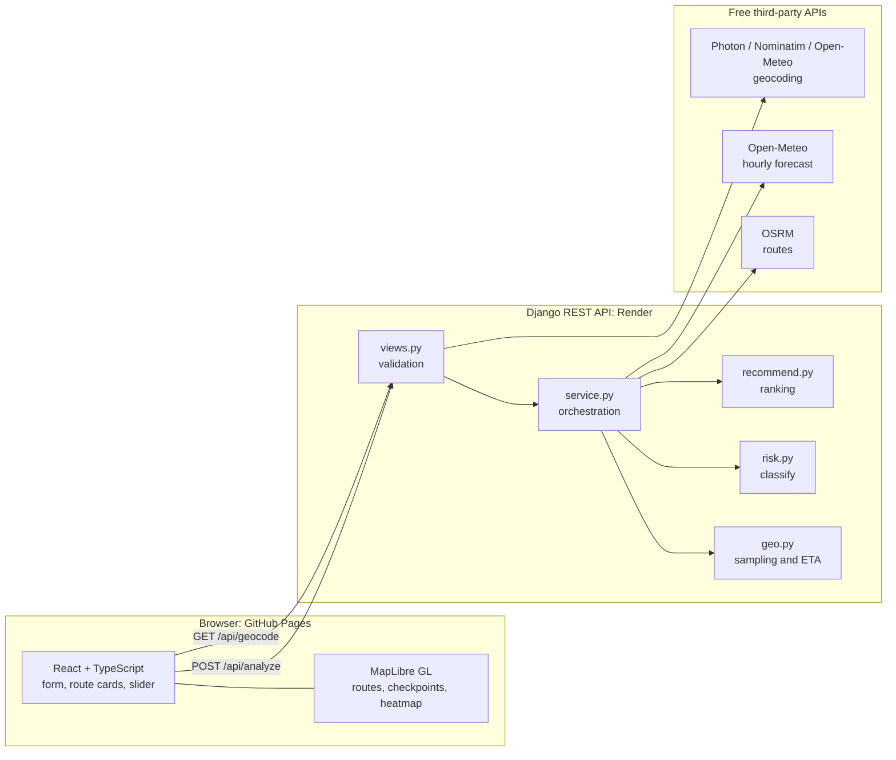
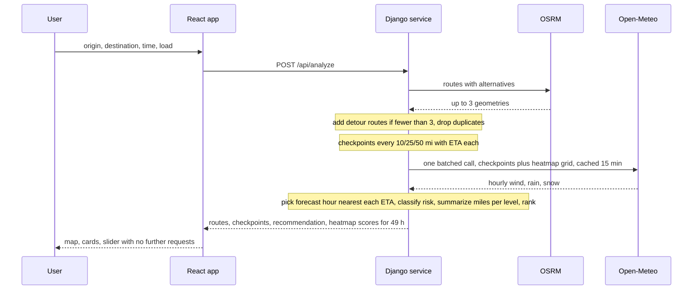
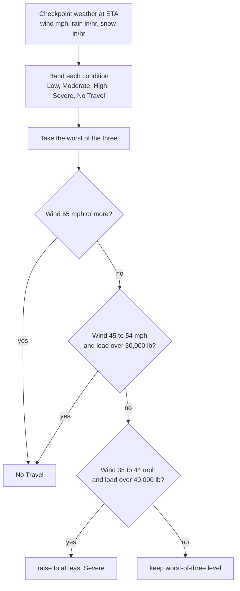
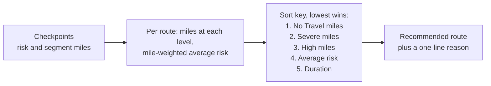
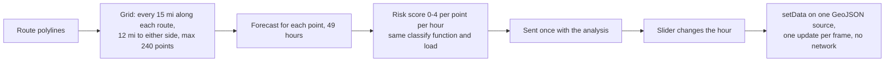

# Architecture

## 1. Requirements coverage

| Requirement | Where | How |
|---|---|---|
| Inputs: origin, destination, departure time, load | `SearchForm.tsx`, `PlaceInput.tsx` | Typeahead geocoding, `datetime-local`, load in lb. Validated again by the API serializer. |
| 3 route options from a routing API | `providers.get_routes` | OSRM alternatives; if fewer than 3 distinct routes, via-point detours are added. Duplicates are removed by geometry similarity. |
| Weather every 10 / 25 / 50 miles at the truck's ETA | `geo.make_checkpoints`, `weather.at_time` | Spacing by trip length (<100 mi: 10, 100-300: 25, >300: 50). ETA is proportional to distance, and the forecast hour nearest the ETA is used. |
| Risk from the provided rules | `risk.classify` | Wind / rain / snow bands, worst one wins, then the load overrides raise it. |
| Recommend best route | `recommend.py` | Lexicographic: Severe miles, High miles, average risk, duration. No Travel miles are compared first (my addition). |
| Map with routes, checkpoints, risk, ETAs, summaries | `MapView.tsx`, `RouteCards.tsx` | Route lines, risk-coloured checkpoints with popups, summary cards, checkpoint table. |
| Heatmap with 0-48 h slider | `service._grid`, `HeatmapControl.tsx` | Grid along the corridor with 49 hourly scores per point, preloaded; the slider swaps one GeoJSON source. |
| Deliverables | GitHub, Pages, Render | Frontend on GitHub Pages, backend on Render. |

## 2. System overview

## 3. What happens on one request

## 4. Risk classification (per checkpoint)

## 5. Route recommendation

Each checkpoint represents half the distance to each neighbour, so miles per risk level add up to the route length.

## 6. Heatmap data flow

## Design decisions

- **Pure functions for logic.** `risk.py`, `geo.py` and `recommend.py` have no I/O, so the rules are covered by fast unit tests.
- **One response, no slider requests.** The heatmap ships with the analysis so scrubbing stays smooth.
- **Blurred circles, not a density heatmap.** Colour always means the real risk level and does not inflate where points overlap.
- **Resilience.** Weather calls are batched, cached and parallel; geocoding falls back across three providers.
